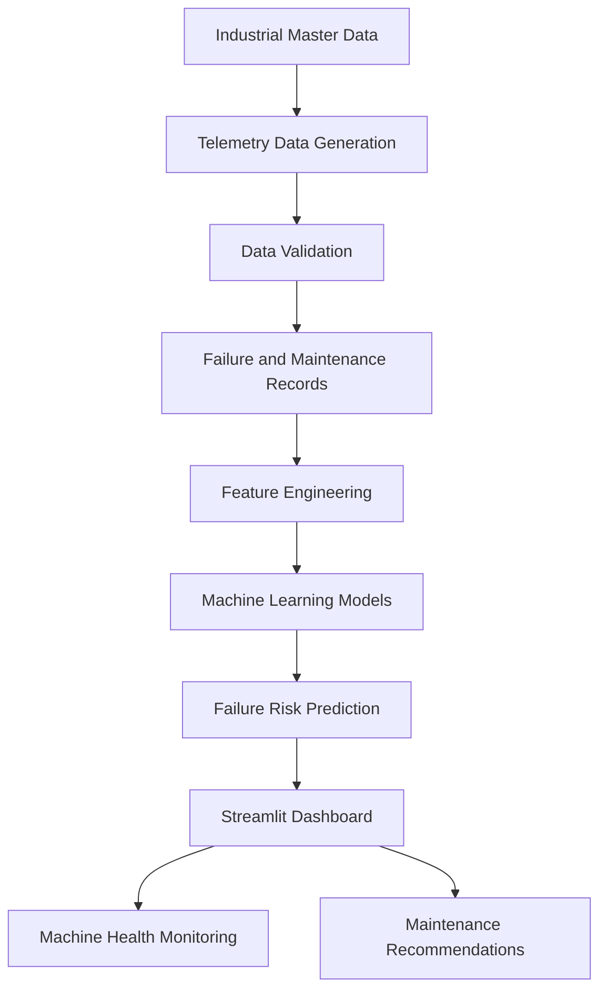

# Industrial Predictive Maintenance System

An end-to-end Industrial Predictive Maintenance System that uses machine sensor telemetry and machine learning to identify potential equipment failures before they occur.

The project generates synthetic industrial telemetry data, performs data validation and feature engineering, trains machine learning models, predicts machine failure risk for the next seven days, and visualizes the results through an interactive Streamlit dashboard.

## Project Overview

Unexpected machine failures can cause production downtime, increased maintenance costs, and operational disruptions.

This project demonstrates a predictive maintenance workflow that analyzes historical sensor readings and operating conditions to identify machines that may be at risk of failure.

### Key Highlights

- 3 industrial plants across Hyderabad, Chennai, and Pune.
- 12 production lines.
- 100 industrial machines.
- 500 sensors.
- 2.16 million synthetic telemetry readings covering 90 days.
- 100 generated failure events.
- 150 maintenance work orders.
- Machine-level failure prediction for the next 7 days.
- Interactive Streamlit dashboard.
- Data-quality and database-integrity validation.

## System Architecture



## Technologies Used

| Category | Technologies |
|---|---|
| Programming | Python |
| Data Processing | Pandas, NumPy |
| Machine Learning | Scikit-learn |
| Models | Random Forest, Gradient Boosting |
| Database | SQLite |
| Visualization | Streamlit, Plotly |
| Data Storage | CSV, JSON, SQLite |
| Environment Management | uv |
| Version Control | Git, GitHub |

## Dataset Description

The project generates synthetic industrial data using a fixed random seed of `20261022`.

| Dataset | Records |
|---|---:|
| Plants | 3 |
| Production Lines | 12 |
| Machines | 100 |
| Sensors | 500 |
| Telemetry Events | 2,160,000 |
| Failure Events | 100 |
| Maintenance Work Orders | 150 |
| Engineered Feature Records | 9,000 |

### Sensor Types

Each machine is monitored using five sensor types:

- Temperature
- Vibration
- Pressure
- Current
- Speed

Telemetry readings are generated at 30-minute intervals over 90 days.

## Machine Learning Workflow

### 1. Data Generation

Generate industrial master data, machine telemetry, failure events, maintenance work orders, and exceptional scenarios.

### 2. Data Validation

Validate primary keys, foreign keys, data ranges, sensor relationships, timestamps, and maintenance timelines.

### 3. Feature Engineering

Extract machine-level daily features from sensor readings, including:

- Mean sensor values
- Minimum and maximum readings
- Standard deviation
- Latest sensor readings
- Reading counts
- Seven-day rolling averages
- Seven-day rolling standard deviations

### 4. Model Training

Train and compare:

- Random Forest Classifier
- Gradient Boosting Classifier

A chronological split is used to evaluate future-period predictions.

### 5. Failure Prediction

Predict whether a machine is likely to experience a failure within the next seven days.

The output includes a predicted failure probability and a risk category.

## Model Evaluation

The selected Random Forest model produced the following results on the historical test period:

| Metric | Result |
|---|---:|
| Accuracy | 99.11% |
| Precision | 87.23% |
| Recall | 80.39% |
| F1 Score | 83.67% |
| ROC-AUC | 99.72% |
| PR-AUC | 83.52% |

Confusion Matrix:

```text
                 Predicted
                 Normal  Failure

Actual Normal     1743      6
Actual Failure      10     41
```

**Evaluation note:** These results are from a synthetic dataset. The test period was also used during model selection, so the reported metrics should be treated as development results rather than an independent estimate of real-world performance.

## Interactive Dashboard

The Streamlit dashboard provides:

- Plant, production line, and machine KPIs.
- Machine failure risk distribution.
- Machine-wise failure probability.
- Historical failure analysis.
- Maintenance work-order information.
- Temperature, vibration, pressure, current, and speed monitoring.
- Machine-specific health and risk details.
- Historical risk trends.
- Maintenance recommendations.


### Dashboard Screenshots

#### 1. Dashboard Overview


#### 2. Machine Risk Distribution


#### 3. Sensor Monitoring


#### 4. Machine Health and Details


## Project Structure

```text
Predictive-Maintenance/
│
├── dashboard/
│   └── app.py
│
├── docs/
│   ├── architecture.md
│   └── data_dictionary.md
│
├── src/
│   ├── database/
│   ├── generators/
│   ├── models/
│   ├── preprocessing/
│   ├── predictive_maintenance/
│   └── validation/
│
├── tests/
│
├── config.py
├── main.py
├── pyproject.toml
├── uv.lock
├── requirements.txt
├── README.md
└── .gitignore
```

Generated datasets, database files, and model artifacts are excluded from Git tracking. They are generated locally using the project scripts.

## Installation and Setup

### Prerequisites

- Python 3.12 or compatible version
- Git
- uv package manager

### 1. Clone the repository

```bash
git clone https://github.com/Ganesh9573799445/industrial-predictive-maintenance.git
cd industrial-predictive-maintenance
```

### 2. Install dependencies

```bash
uv sync
```

### 3. Generate the datasets

Run the generator scripts in the appropriate order:

```bash
uv run python src/generators/master_data.py
uv run python src/generators/telemetry_generator.py
uv run python src/generators/failure_generator.py
uv run python src/generators/maintenance_generator.py
uv run python src/generators/exception_generator.py
```

### 4. Initialize the database

```bash
uv run python src/database/init_db.py
```

### 5. Validate the generated data

```bash
uv run python src/validation/validate_data.py
uv run python src/validation/validate_telemetry.py
uv run python src/validation/validate_exceptions.py
uv run python src/validation/validate_database.py
```

### 6. Perform feature engineering

```bash
uv run python src/preprocessing/feature_engineering.py
```

### 7. Train the machine learning model

```bash
uv run python src/models/train.py
```

### 8. Generate machine predictions

```bash
uv run python src/models/predict.py
```

### 9. Launch the dashboard

```bash
uv run streamlit run dashboard/app.py
```

Open the dashboard at:

`http://localhost:8501`

## Future Improvements

- Integrate real industrial sensor data.
- Implement real-time telemetry ingestion.
- Improve model validation using independent time-based holdout data.
- Add model explainability using SHAP.
- Introduce anomaly detection.
- Implement automated maintenance alerts.
- Deploy the dashboard to a cloud platform.

## Author

**Venkata Ganesh Kongani**

B.E. – Computer Science Engineering

Saveetha School of Engineering, Chennai

GitHub: [Ganesh9573799445](https://github.com/Ganesh9573799445)

## Repository

[Industrial Predictive Maintenance System](https://github.com/Ganesh9573799445/industrial-predictive-maintenance)
